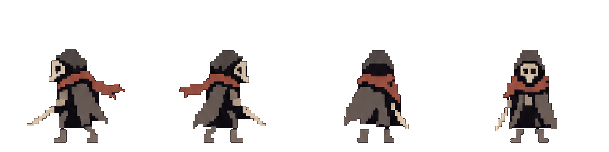
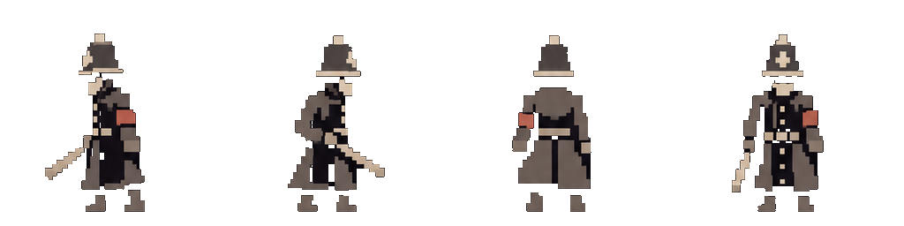
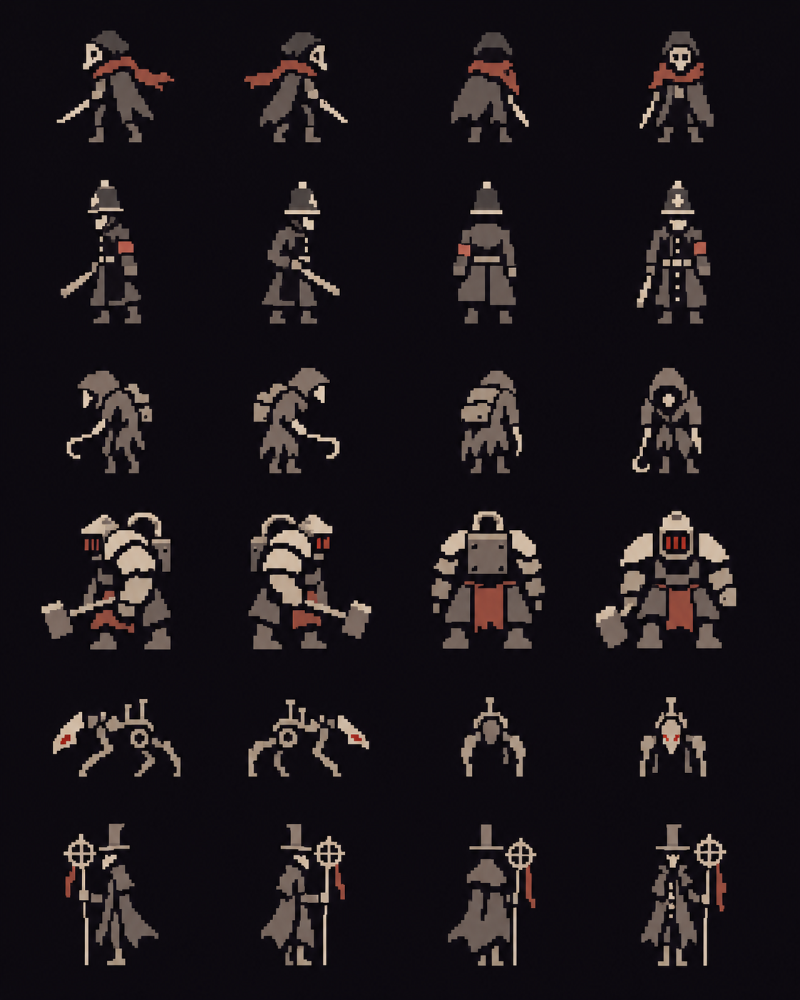

# Gridvail sprite art guide

Use this brief for future player and enemy concepts. The direction combines
minimal pixel silhouettes, Victorian industrial decay and occult machinery.
Bleak Sword is a reference for economy, readability and presentation; create
original characters rather than copying its designs.

## Visual rules

- Build deliberate square pixel clusters. Target roughly 24×32 native pixels
  for a standard humanoid; treat generated images as enlarged concepts until
  their actual pixel grid has been cleaned up.
- Use warm ivory, muted grey and charcoal, with sparse rusty-red accents.
  Keep colours flat inside sprites; add atmospheric lighting in the renderer.
- Recognise roles by silhouette: lean player, tall watchman, hunched scavenger,
  broad furnace guard, low mechanical hound, narrow occult surveyor.
- Suggest worn coats, masks, weapons and machinery with a few large shapes.
  Keep negative space between limbs, equipment and torso. Remove details that
  disappear at gameplay size.
- Aim for about 16–32 simple block or glyph-like components per character.
  This is a simplification budget, not a requirement to use literal text glyphs.
- Keep animation expressive through poses, anticipation and clear timing.
  Preserve body volume and costume between frames.

## Views and sheet layout

Use four directions: left, right, away and toward the camera, viewed from a
slightly elevated three-quarter angle. Match the actual game camera when
preparing production assets. Keep equipment handedness consistent across views;
blindly mirroring an asymmetric character can swap its weapon hand.

Use one character per row and the four directions as columns. Keep equal cell
sizes, consistent scale and a shared foot anchor. Leave padding for weapons.
Use a plain dark background for concept review; request transparency for asset
exports. No labels, scenery, ground shadows, bloom or baked lighting.

The player uses the four-direction pixel character described below. Other
humanoids retain their symbol billboards. Simulation coordinates, collisions,
FOV and actor behaviour remain independent of visual assets.

## Implemented characters: separate static sprite files

Each look has a PNG plus a small RON file in `assets/characters/`:
`trespasser`, `watchman`, `scavenger`, `furnace_guard`, `hound`, `surveyor`.
Each PNG is 1024×256: four equal 256×256 cells, left/right/back/front, with a
common foot baseline. The RON sets display height. Source RGB pixels are
preserved; extraction changes alpha only and does not resample the artwork.

| Actor data file | Sprite look |
| --- | --- |
| player | Trespasser |
| guard, glaiver | Watchman |
| reaper | Scavenger |
| flailer | FurnaceGuard |
| hunter | Hound |
| spearman | Surveyor |

These are presentation assignments; existing combat abilities stay as defined
by each actor's weapon/style data. The roster has five enemy designs, so guard
and glaiver share the watchman.

Each `assets/actors/*.ron` names its `sprite` by generated `CharacterId`.
`build.rs` checks that every character RON has a matching PNG and bundles the
images automatically. The renderer caches one texture per look, shared by all
instances of that look; there is no combined runtime atlas. Actors without a
sprite selection keep text rendering.

Separate files are the editing source of truth. A combined atlas can reduce
texture switches/draw batches when profiling justifies it; it could be packed
at build/load time later without changing how artists edit the files. Six
small textures keep the current pipeline simple.

### Background and opaque interiors

`tools/extract_player_sprites.py` reproduces the files from the approved roster
(run from the repository root with Pillow). It isolates each actor's source
band, finds the outside background and seals hairline outline leaks before
flooding. It does not globally treat black as transparent.

Dark hoods, coat panels and armour can be open to the background in the source
image. `SOLID_PARTS` gives those anatomical parts conservative guide windows.
Within each part, original visible edges bound a row/column fill, protecting
the dark material without forming whole-figure convex hulls or rectangular
opaque patches. Large limb gaps outside the guides stay transparent. Inspect
new extractions over a checkerboard or a light floor; ambiguous source pixels
need explicit foreground guidance rather than a more aggressive colour key.

`python3 tools/test_sprite_cutouts.py` checks black interiors, outline leaks,
real limb gaps, all six PNGs' padding and source RGB preservation.

There is one static image per direction, with no character frame animation.
Existing movement, gestures, lighting and fading place and tint sprites.
Camera and portal turns choose the direction. Enemy alert/thinking markers
stay visible above sprites, and sinking remains retain their look and facing.
Headless/agent consumers keep their simulation glyphs.

Try `?map=arena&reveal&hp=99&walls=stacked` in the preview. WASD/arrows walk,
Q/E rotate, Z zooms and Esc changes wall style.

## Starting roster

| Role | Defining shapes and equipment |
| --- | --- |
| Player / trespasser | Lean cloak, scarf, small mask, short sword |
| Watchman | Tall coat, peaked helmet, baton, red armband |
| Scavenger | Hunched shoulders, worn hood, hook |
| Furnace guard | Wide armour, hammer, small red furnace slit |
| Mechanical hound | Low body, angular legs, narrow mechanical head |
| Occult surveyor | Thin silhouette, tall narrow hat, long instrument staff |

These are visual concepts, not a commitment to six gameplay actor types.

## Reusable generation prompt

> Create a sprite concept sheet for GRIDVAIL, a Victorian industrial occult
> game. Use minimalist pixel art with crisp square clusters, strong silhouettes
> and economical detail. Characters should feel designed at approximately
> 24×32 native pixels, enlarged with nearest-neighbour scaling.
>
> Palette: warm ivory, muted grey and charcoal, with sparse rusty-red accents.
> Use flat colours within sprites.
>
> Character: [ROLE, BODY SHAPE, CLOTHING AND EQUIPMENT].
>
> Show four matching views: left, right, back and front, suitable for a
> square-grid game viewed from a slightly elevated three-quarter camera.
> Keep character scale, equipment, handedness, proportions and foot anchor
> consistent. Separate limbs clearly from the torso.
>
> Present in evenly spaced cells on a solid dark background. No text, scenery,
> shadows, bloom, gradients, antialiasing or painterly texture. Prioritise
> readability at small size. Create original character designs.

For continuity, attach the approved roster and append:

> Match the reference's palette, pixel density, proportions and simplification.
> Change only [REQUESTED CHANGE].

## Generated reference sheet

The generated concept sheet above is included in the repository. Rows show the
player, watchman, scavenger, furnace guard, mechanical hound and occult surveyor;
columns show left, right, back and front. Attach this PNG when generating new
concepts. It is a visual reference, not a production-ready animation atlas;
apply the cleanup checks below before runtime use.

## Production cleanup and acceptance

1. Review at actual gameplay size on both dark and light floors. Every role
   should remain recognisable without its red accent.
2. Rebuild or clean onto an exact pixel grid and fixed palette. Do not assume
   the generator followed the requested native resolution or equal cell sizes.
3. Check all directions for matching proportions, costume and weapon hand.
4. Export isolated frames with transparent backgrounds, equal dimensions and
   an identical foot anchor; use nearest-neighbour filtering.
5. Check animation for sliding feet, changing volume and equipment flicker.
6. Review with the game's lighting and camera. Keep readability before adding
   bloom, depth of field or other presentation effects.
